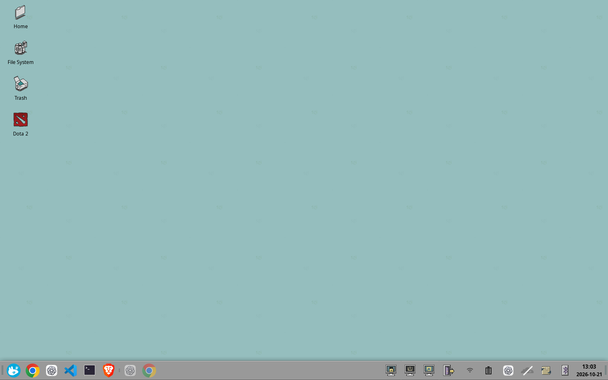
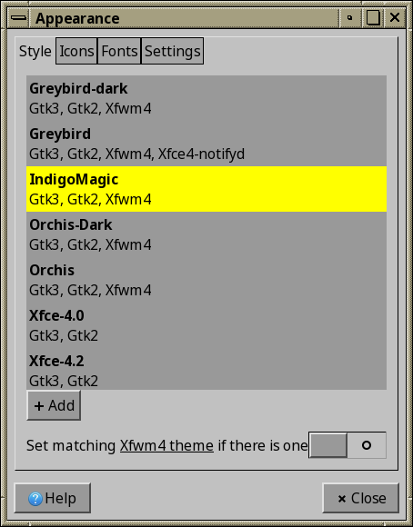
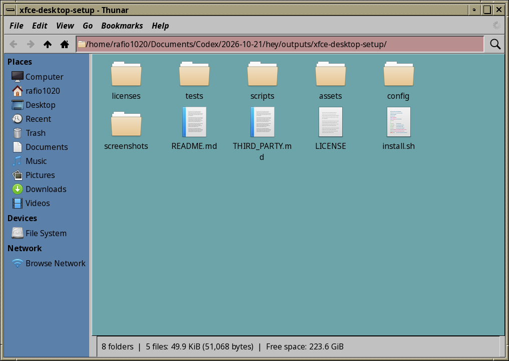
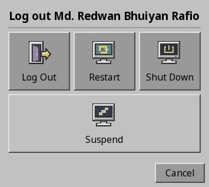

# IndigoMagic XFCE desktop

My SGI-inspired XFCE desktop, captured from Fedora 44: a tiled teal wallpaper, classic IndigoMagic windows, retro icons, red cursor, and one full-width bottom panel.

Bring the same setup to **Fedora, Ubuntu/Debian, or CachyOS/Arch** with the included installer. The configuration and visual assets are bundled; no theme-site downloads are needed during installation.



## What you get

- IndigoMagic GTK 3 and XFWM4 theme, including the local desktop-selection styling changes.
- SGI elementary icons, custom IndigoMagic panel/status icons, and the redSGI cursor.
- Sprinkle wallpaper and the original SGI bitmap fonts.
- One 60-pixel bottom panel, 44-pixel launcher icons, Whisker Menu, grouped task buttons, session actions, system tray, and clock. The extra default XFCE dock/panel is replaced by this layout.
- Custom GTK CSS for stable button sizes, the dark Whisker Menu, and an outlined desktop selection rectangle.
- Window behavior and keyboard shortcuts; Alt+F1 opens Whisker Menu.
- Automatic per-user backups, rollback on an installation error, and an explicit restore command.

<details>
<summary>Appearance and window borders</summary>



</details>

<details>
<summary>Thunar file manager</summary>



Thunar showing this repository, with the themed window borders, toolbar, sidebar, and file view.

</details>

<details>
<summary>Suspend and power dialog</summary>



The themed XFCE session dialog showing Log Out, Restart, Shut Down, and Suspend. Available power actions depend on the destination PC.

</details>

These are real screenshots of the source desktop. Application icons, desktop files such as the game shortcut, running apps, and tray items depend on what is installed on your PC. They are not all installed by this repository.

## Requirements and compatibility

| System | Package installation | Validation |
| --- | --- | --- |
| Fedora, traditional dnf installation | `dnf` | Source: Fedora 44, XFCE 4.20 / X11; exported configuration verified with xfconf |
| Ubuntu / Debian and derivatives | `apt-get` | Package branch provided; full desktop installation not yet tested |
| CachyOS / Arch and derivatives | `pacman` | Package branch provided; full desktop installation not yet tested |

Use **XFCE on X11**, preferably XFCE 4.20. XFCE 4.18 may differ in the menu, tray, clock, and font rendering. This is an XFCE desktop configuration, so select XFCE at login even if your distribution normally uses GNOME or KDE.

Python 3.10+, Bash, and a normal user account are required. The included redSGI cursor license restricts supported CPU architectures to x86/x86_64/amd64/ia64; the installer checks this. Fedora Atomic and custom `XDG_CONFIG_HOME` / `XDG_DATA_HOME` locations need a manual installation and are not supported by the automated installer.

## Install on another PC

### 1. Get the repository

Install Git with your distribution's package manager if needed, then:

```bash
git clone https://github.com/rafio1020/xfce-desktop-setup.git
cd xfce-desktop-setup
```

If you download GitHub's ZIP instead, extract it and use `bash install.sh` in place of `./install.sh` if executable permissions were not preserved.

### 2. Preview and install dependencies

```bash
./install.sh --dry-run
./install.sh --packages --dry-run
./install.sh --packages
```

The first two commands only print a plan. The package command detects your distribution, installs XFCE, its X11 server, Whisker Menu, utilities, and fonts support, and asks for your sudo password if required. It does not apply the desktop settings.

On CachyOS/Arch it uses **`pacman -Syu --needed`**, which also upgrades the system to avoid a partial upgrade. Ubuntu may require the **Universe** repository to be enabled if XFCE packages cannot be found. An existing graphical login manager is expected; the script does not replace or reconfigure it.

If you have never used XFCE on the destination PC, log out, choose **XFCE / Xfce Session** in your login screen's session selector, and log in once so its initial setup completes. Then log out again.

### 3. Apply while logged out of XFCE

Save your work and **log out completely**. Switching to a text console while leaving XFCE running is not enough.

Press **Ctrl+Alt+F3**, log in with your usual username and password, and run:

```bash
cd ~/xfce-desktop-setup
./install.sh --apply
```

Use the actual clone directory if it is elsewhere. **Do not use sudo for `--apply` or `--restore`.**

The installer refuses to run while your XFCE session, panel, desktop, or configuration service is running. XFCE keeps settings in memory and can overwrite imported XML; applying from a logged-out session avoids that conflict. [XFCE configuration documentation](https://docs.xfce.org/xfce/xfconf/start)

To match the source desktop's 112 DPI explicitly:

```bash
./install.sh --apply --dpi 112
```

Otherwise, the destination's configured font DPI is preserved. Monitor resolutions and display layouts are never copied.

### 4. Log into XFCE

Return to the graphical login screen, usually with **Ctrl+Alt+F1** or **Ctrl+Alt+F2**, and select XFCE. If neither brings back the greeter, reboot after the installer finishes.

The wallpaper helper runs at first login, waits for XFCE's monitor properties, and applies Sprinkle to the destination's detected wallpaper slots. For a fresh profile without saved backdrop properties, it uses XRandR monitor names. It then marks itself complete. It does not keep overriding wallpaper changes on later logins.

## What changes, and what stays yours

The installer replaces the five listed XFCE configuration channels, panel launchers, and your GTK 3 `gtk.css`. It installs its own theme, icon, font, wallpaper, and first-login helper directories. All replaced paths are backed up first.

```text
~/.config/xfce4/xfconf/xfce-perchannel-xml/
    xsettings.xml
    xfwm4.xml
    xfce4-panel.xml
    xfce4-desktop.xml
    xfce4-keyboard-shortcuts.xml
~/.config/xfce4/panel/
~/.config/gtk-3.0/gtk.css
~/.themes/IndigoMagic/
~/.icons/{sgi-elementary-xfce,IndigoMagic-Panel,redSGI}/
~/.local/share/fonts/indigomagic/
~/.local/share/xfce-desktop-setup/
~/.config/autostart/xfce-desktop-setup.desktop
~/.config/fontconfig/conf.d/99-indigo-screen-font.conf
```

Other themes, documents, browser data, network settings, GTK bookmarks, hardware settings, and other autostart entries are left alone. No personal histories, saved sessions, device identifiers, network names, or original home-directory paths are included in the exported configuration.

If you use a separate dock app such as Plank, disable its autostart yourself. This setup replaces XFCE's panel layout; it does not uninstall other desktop environments or dock programs.

## Launchers and applications

The five launchers retain the original order: Chrome/browser, ChatGPT, Code/editor, terminal, Brave/browser. The installer detects installed applications:

| Original app | Detection and fallback |
| --- | --- |
| Chrome | Native Chrome/Chromium, then your preferred browser |
| ChatGPT | Native `chatgpt`, otherwise the ChatGPT website in your browser |
| VS Code | Native Code/Code OSS/VSCodium, then VS Code Flatpak; otherwise opens the file manager |
| Terminal | GNOME Terminal if installed, otherwise XFCE Terminal |
| Brave | Native Brave, then Brave Flatpak, otherwise your preferred browser |

Chrome, ChatGPT, VS Code, Brave, and games are **not installed automatically**. Install your preferred apps separately, then edit a launcher's properties to point to it. Choose your browser under XFCE **Settings → Preferred Applications**. Modern GTK 4/libadwaita and some Qt/Electron apps may not follow this GTK 3 theme.

## Restore the previous desktop

Each application creates a new backup under:

```text
~/.local/state/xfce-desktop-setup/backups/
```

The exact path is printed before any settings are replaced. Keep that path. To see existing backups:

```bash
ls -1 ~/.local/state/xfce-desktop-setup/backups/
```

Log out of XFCE, switch to a text console, then run this with your actual backup directory:

```bash
cd ~/xfce-desktop-setup
./install.sh --restore ~/.local/state/xfce-desktop-setup/backups/YOUR-BACKUP-DIRECTORY
```

Restore returns every managed path to the snapshot, including removing theme files that were absent before installation. It replaces later edits to those same managed paths; save them separately if you want to keep them. It leaves unrelated files and installed system packages alone. Log back into XFCE afterward. Keep the repository until you no longer need its restore command.

## Troubleshooting

**The installer says XFCE is still running.** Log out from the desktop menu first. If a leftover `xfconfd` remains, reboot and sign into the text console before logging into XFCE. The script deliberately does not kill your desktop processes.

**There is no XFCE session at login.** Check that `--packages` completed and your login manager supports X11 sessions. This script does not switch display managers. Restarting the computer may refresh the session list.

**Wallpaper did not change.** After logging into XFCE, run:

```bash
python3 ~/.local/share/xfce-desktop-setup/first-login.py
```

To intentionally reapply it after adding a monitor:

```bash
touch ~/.local/share/xfce-desktop-setup/wallpaper-pending
python3 ~/.local/share/xfce-desktop-setup/first-login.py
```

You can also select `~/.local/share/xfce-desktop-setup/wallpapers/Sprinkle.png` in Desktop Settings and choose the **Tiled** style.

**Panel position or size needs adjustment.** Right-click the panel → Panel Preferences. It is a full-width bottom panel; monitor geometry is intentionally not cloned from the source laptop. Adjust the panel size and icon size there for your screen.

**Fonts look different.** The installer includes the source PCF fonts and a user-level Fontconfig rule accepting the Screen family. Some modern GTK/Pango stacks cannot render these bitmap fonts. Use **Sans Bold 10** as the window-title fallback in Window Manager settings, or choose another installed font. No system font configuration is removed.

**A menu plugin is missing.** Install `xfce4-whiskermenu-plugin` through your package manager. The other panel items are built into XFCE Panel.

## Repository contents

```text
install.sh                 Command-line entry point
scripts/packages.sh        Distribution-specific package installation
scripts/setup.py           Staging, backups, installation, and restore
scripts/first-login.py     Wallpaper setup for destination monitor names
config/                    Sanitized XFCE XML and custom GTK CSS
assets/indigomagic.tar.gz   Themes, icons, cursor, fonts, and wallpaper
assets/SHA256SUMS           Archive integrity check
assets/manifest.json       Source desktop metadata
screenshots/               Actual source desktop screenshots
licenses/                  Third-party notices and license texts
tests/                     Isolated installer and wallpaper tests
.github/workflows/         Automatic GitHub validation
```

To inspect the archive:

```bash
tar -tzf assets/indigomagic.tar.gz
```

## Validation and contributing

```bash
bash -n install.sh scripts/packages.sh
(cd assets && sha256sum -c SHA256SUMS)
python3 -m unittest discover -s tests -v
```

Tests cover a temporary-home installation and restore, rollback after a simulated write failure, retained DPI, safe paths and symlinks, asset integrity, offline-session checks, and wallpaper monitor handling. Exported channels were also loaded with Fedora's actual `xfconf-query` in an isolated D-Bus session. These checks do not constitute a complete installation test on Ubuntu or CachyOS.

For a compatibility report, include your distribution, XFCE version (`xfce4-panel --version`), X11/Wayland session type, the exact command and error, and a screenshot if relevant. Do not attach a complete home-directory backup.

## Credits and licensing

The upstream visual theme is **IndigoMagic**, distributed by Dave Maldonado as an SGI-style theme pack. This repository captures my local customization of that pack. See [THIRD_PARTY.md](THIRD_PARTY.md) for upstream links, modifications, and retained notices.

The installer and original configuration contributions use [GPL-3.0](LICENSE). Bundled artwork, fonts, themes, and icons retain their applicable upstream terms; in particular, the redSGI cursor has its own included MaXX license and the XFWM4 theme has a separate attribution notice. This project is not affiliated with SGI, MaXX, or the application vendors shown in the screenshots.
